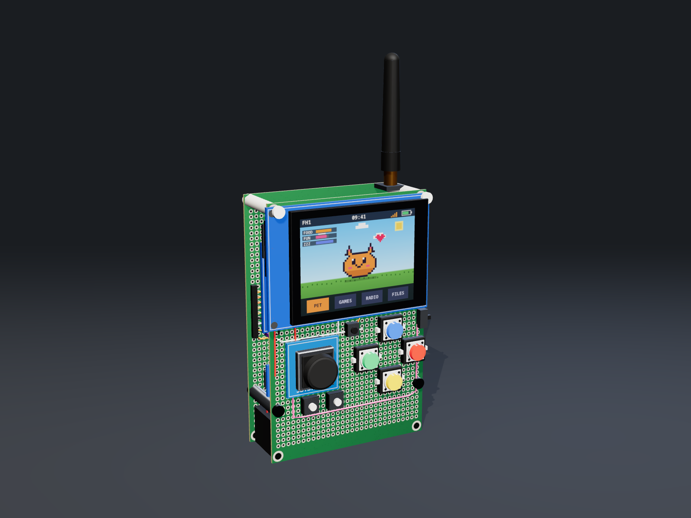

# FH1

A modular, pocket-sized handheld built on an ESP32-S3, hand-wired on two 12 × 8 cm perfboards. It runs "apps": Game Boy Color, NES and Master System emulators, a music player, games installed as packages, and anything else that fits (network tools, device-to-device messages over LoRa).

  

*Concept render of the V1 build, made by [`hardware/layout/concept-render.html`](hardware/layout/concept-render.html) from the layout's positions and wires.*

It borrows its building style from an ESP32-S3 Wi-Fi bridge built earlier: modules on 2.54 mm round-pin sockets, so each one can be swapped or reworked.

## Goals

- **Pocket size:** two 120 × 80 mm perfboards in a sandwich, one 18650 cell.
- **Colour screen:** 2.8" IPS, 320 × 240, fast enough for 60 fps Game Boy Color emulation.
- **Controls:** a PSP-style thumbstick and lit A, B, X, Y buttons in the SNES layout, plus Start, Select and Menu. No touch screen.
- **Audio:** a mono speaker and a microphone, voice quality.
- **Battery life first:** hours of play, days of standby.
- **Storage and updates:** micro-SD for ROMs and data; firmware and app updates over the air.
- **Radio:** 2.4 GHz LoRa between FH1 devices (messages, multiplayer).

## Status

The parts for **two devices** are bought; placement is drawn and wiring routed; nothing is soldered yet. The firmware runs on a Guition ESP32-4848S040 dev board (`firmware/README.md`), with Bluetooth controllers through an ESP32 bridge (`bridge/`).

## Layout

| Path | What |
|---|---|
| `hardware/requirements.md` | Features turned into hardware requirements |
| `hardware/architecture.md` | Block diagram, buses, power tree, GPIO budget, power budget |
| `hardware/parts.md` | Parts list |
| `hardware/layout.md` | Mechanical plan: the two boards, what goes on each face |
| `hardware/wiring.md` | GPIO map, MCP23017 pin allocation, power rails, routing rules |
| `hardware/layout/board-render.html` | The layout drawn: both faces of both boards, the side section, parts as placed (open in a browser) |
| `hardware/layout/concept-v1-*.png` | 3D renders of the V1 build (front, laid open, back), made by `concept-render.html` (open it in a browser; buttons switch the view) |
| `hardware/modules/` | Module notes: dimensions and pinouts read off the sellers' drawings |
| `hardware/open-questions.md` | Decisions, and the questions still open |
| `firmware/PLAN.md` | Firmware design: boards, devices, interface, packages, emulators, music, bridge, users |
| `firmware/` | The firmware (ESP-IDF v6.1): build, flash and app notes in `firmware/README.md` |
| `bridge/` | The Bluetooth bridge's firmware (ESP32 + Bluepad32) |
