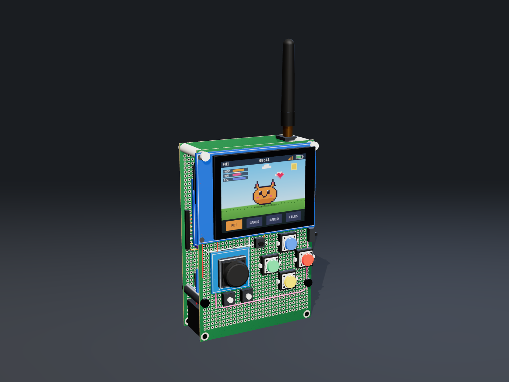

# FH1

A modular, pocket-sized handheld built on an ESP32-S3, hand-wired on two 12 × 8 cm perfboards. It runs "apps": Game Boy Color, NES and Master System emulators, a music player, games installed as packages, and anything else that fits (network tools, device-to-device messages over LoRa).

  

*Concept render of the V1 build, made by [`hardware/layout/concept-render.html`](hardware/layout/concept-render.html) from the layout's positions and wires.*

**Try it in the browser:** [acesso.github.io/fh1](https://acesso.github.io/fh1/) runs the real firmware on an emulated FH1 (`simulator/`).

It borrows its building style from an ESP32-S3 Wi-Fi bridge built earlier: modules on 2.54 mm round-pin sockets, so each one can be swapped or reworked.

## Goals

- **Pocket size:** two 120 × 80 mm perfboards in a sandwich, one 18650 cell.
- **Colour screen:** 2.8" IPS, 320 × 240, fast enough for 60 fps Game Boy Color emulation.
- **Controls:** a PSP-style thumbstick and lit A, B, X, Y buttons in the SNES layout, plus Start, Select and Menu. No touch screen.
- **Audio:** a mono speaker and a microphone, voice quality.
- **Battery life first:** hours of play, days of standby.
- **Storage and updates:** micro-SD for ROMs and data; firmware and app updates over the air.
- **Radio:** 2.4 GHz LoRa between FH1 devices (messages, multiplayer).

## Status

The parts for **two devices** are bought; placement is drawn and wiring routed; nothing is soldered yet. The firmware runs on a Guition ESP32-4848S040 dev board (`firmware/README.md`), with Bluetooth controllers through an ESP32 bridge (`bridge/`). Releases and what each added: `CHANGELOG.md`.

## Ideas

Future ideas and pending work; each leaves this list when it lands.

- **Asset import toolkit (SDK):** offline tools that fit a sprite sheet or sound from any source to the FH1. They check a sprite set has the frames an app needs (isometric or plain 2D), check audio and downsample or convert it, using ffmpeg or ImageMagick when installed. They build on `firmware/tools/fh1art.py` and `firmware/tools/fh1sfx.py`.
- **2D → isometric converter:** a best-effort tool that turns plain 2D sprites into isometric ones.
- **Game engine in the SDK:** the isometric engine (`firmware/apps/packages/taticas-da-ilha/main`: maps, units, four views, scenery animations, art packs, effects) as a firmware module offered through the SDK, so games share one copy.
- **Theme and sound packages:** themes and voices as installable packages (the palette, the look's pictures as
  art, the sounds as a bank) listed in the Temas app beside the built-in ones, with a live preview; footer chips
  and status icons drawn by the look too.
- **Releases:** each release carries the firmware for every board (`fh1`, `guition`) as its own download.
- **Simulator:**
  - faster in the browser;
  - the micro-SD card and Wi-Fi.
- **FH1 hardware:** a third GPIO expander on the second board for the camera and later modules; a faster display
  link, first 80 MHz SPI tested on the built board, then an 8-bit 8080 bus if needed (`hardware/open-questions.md`
  22 and 23).
- **FH1 board firmware:** the ES8311 codec setup, the micro-SD slot, the battery level, the IMU, the L and R buttons (wired; the input set has no L/R keys yet).
- **Táticas da Ilha:**
  - difficulty that adapts to the player;
  - the shadow villain (he first shows himself when the island grows: a hero's body in dark violet) fought as
    the game's last boss, his own art and attacks;
  - something new for the party in fase 3, as the fourth hero is in fase 2;
  - bosses with skills of their own and sizes beyond twice (a boss's own entrance and attacks, drawn for it);
  - spells with art of their own at each tier;
  - Mythlit (the rainbow crystal spirit, its sheet already in `assets/packs/ragnarok-enemies/`) somewhere: a rare
    creature, or the Elementals' guard;
  - the fase 3 Elementals with art of their own (the fase 2 spirits' kind).
- **Construção Legal:**
  - more to stack: a storey on houses beyond the 2 x 2 one, on the smithy;
  - more moving things: smoke from houses with a chimney, water, people in the village;
  - with friends: what each one built kept as theirs (only they, or the world's owner, remove it).
- **Probe tools (an app):** a logic probe and frequency counter on a pin, a logic analyzer (8 or 16 pins captured
  through the S3's LCD_CAM into PSRAM, tens of MHz in bursts) and an audio-range oscilloscope (the ADC by DMA, about
  80,000 samples a second, 0-3.1 V; other ranges need an input stage). Needs an SDK capability that grants a few
  designated pins to an app, and a small probe header (the FH1 board has almost no free GPIOs).
- **Roaming profiles:** a user's saves and settings following them between units: a user who plays on another FH1
  brings their saved states along (fetched from their home unit over Wi-Fi, signed with their key), plays there,
  and their progress goes back; conflicts shown when both sides changed. Today a saved state can be put into a
  user's folder by hand (`POST /fh1/state`, `firmware/docs/users.md`).
- **Doom:**
  - music (the WAD's MUS songs through an OPL synthesizer on the audio stream);
  - saved games and the menus on the FH1's keys, a WAD picker;
  - the FH1's own content for its FPS engine, and play with friends over the network;
  - on the radio unit: the 256-colour full screen and 8-bit sounds (SDK 0.10) in its firmware;
  - faster: the masked walls and sprite clipping, the SD card at 40 MHz.
- **Isometric engine:** ground under a floating slab (a cell with a column and a slab over it), and a shadow
  on it.

## Layout

| Path | What |
|---|---|
| `hardware/requirements.md` | Features turned into hardware requirements |
| `hardware/architecture.md` | Block diagram, buses, power tree, GPIO budget, power budget |
| `hardware/parts.md` | Parts list |
| `hardware/layout.md` | Mechanical plan: the two boards, what goes on each face |
| `hardware/wiring.md` | GPIO map, MCP23017 pin allocation, power rails, routing rules |
| `hardware/layout/board-render.html` | The layout drawn: both faces of both boards, the side section, parts as placed (open in a browser) |
| `hardware/layout/concept-v1-*.png` | 3D renders of the V1 build (front, laid open, back), made by `concept-render.html` (open it in a browser; buttons switch the view) |
| `hardware/modules/` | Module notes: dimensions and pinouts read off the sellers' drawings |
| `hardware/open-questions.md` | Decisions, and the questions still open |
| `firmware/PLAN.md` | Firmware design: boards, devices, interface, packages, emulators, music, bridge, users |
| `firmware/docs/sdk.md` | The SDK guide: writing apps and games for the FH1, the isometric engine, testing, limits |
| `firmware/docs/doom.md` | Doom (PrBoom) as a package: its WAD from the SD card or over the network, how it runs, its speed, development |
| `firmware/docs/construcao-legal.md` | Construção Legal, the exploration (and building) game: its world, friends in one world over the network, sounds, drawing, development |
| `firmware/` | The firmware (ESP-IDF v6.1): build, flash and app notes in `firmware/README.md` |
| `bridge/` | The Bluetooth bridge's firmware (ESP32 + Bluepad32) |
| `simulator/` | The web simulator and the site: the FH1 firmware on esp32sim in the browser |
